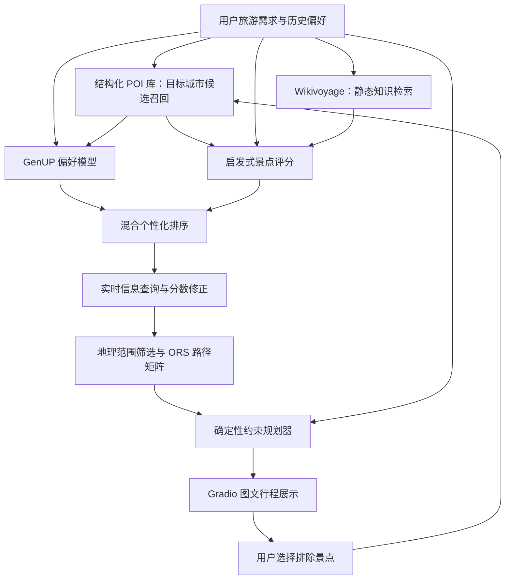

# TripMind：基于大语言模型的个性化旅游推荐与行程规划实验报告

## 一、实验目的

### 1.1 实验背景

旅游推荐不仅需要判断用户可能喜欢哪些景点，还需要综合考虑出游时间、预算、同行人群、交通方式、景点开放时间以及天气等外部因素。传统基于规则的推荐方法容易受到人工权重和预设标签的限制，而直接使用大语言模型生成完整行程，又可能出现虚构景点、时间安排不合理、预算超限和路线距离不准确等问题。

本实验设计并实现 TripMind，一个融合大语言模型个性化偏好学习、检索增强生成（Retrieval-Augmented Generation，RAG）相关技术、实时信息检索、地图路径服务及确定性约束规划的旅游推荐系统。系统将用户偏好建模与行程可行性判断分离，通过学习得到的偏好信号辅助景点选择，再借助外部知识与显式约束生成结构化的旅游行程。

### 1.2 实验目标

- **个性化推荐：** 综合用户年龄段、旅行兴趣、同行人群、出游节奏及历史访问记录，对目的地中的候选兴趣点（Point of Interest，POI）进行排序。
- **知识增强：** 利用公开旅游数据库及旅游指南补充景点信息，减少对大语言模型内部知识的依赖。
- **实时感知与约束规划：** 结合天气、临时闭馆等动态信息，以及地图服务提供的距离和交通耗时，在预算、时间和开放时间约束下安排每日行程。
- **交互式展示：** 基于 Gradio 实现旅游需求输入、图文行程展示、景点排除与重新规划。
- **实验验证：** 通过离线排序评测、监督微调实验、消融实验和端到端功能测试，分析大语言模型对个性化推荐的作用及系统的可行性。

## 二、数据集介绍

本实验采用多源数据，各数据集分别承担用户行为学习、结构化景点供给、旅游需求建模和静态知识检索等职责，而非将所有信息统一作为模型微调语料。

| 数据集 | 数据内容 | 本实验用途 |
| --- | --- | --- |
| GenUP：FourSquare-NYC | 纽约用户画像、历史签到轨迹和下一 POI | 个性化类别偏好学习与评测 |
| GenUP：FourSquare-TKY | 东京用户画像、历史签到轨迹和下一 POI | 个性化类别偏好学习与评测 |
| GenUP：Gowalla-CA | 加利福尼亚用户画像、历史签到轨迹和下一 POI | 个性化类别偏好学习与评测 |
| ChinaTravel | 自然语言旅行请求、出发地、目的地、天数、人数及约束 | 旅游需求样本、文本微调和系统测试 |
| ChinaTravel-Sandbox | 景点、餐饮、住宿、交通等结构化信息 | 候选景点库与静态规划信息 |
| Wikivoyage | 中英文旅游指南 | 静态旅游知识检索 |

### 2.1 GenUP 用户画像与 POI 行为数据

GenUP 基于位置社交网络签到数据构建自然语言用户画像及下一 POI 预测样本。项目使用纽约、东京和加利福尼亚三个数据子集，原始样本主要包含以下字段：

| 字段 | 含义 |
| --- | --- |
| `system_prompt` | 根据历史行为生成的用户画像，如兴趣、日常习惯及行为倾向 |
| `inputs` | 用户历史访问轨迹，包含时间、POI 编号及类别等信息 |
| `targets` | 真实的下一次访问 POI |

与仅使用人工偏好规则相比，这类数据能够提供基于实际访问行为的监督信号。需要注意，GenUP 画像是由历史行为推导生成的，其中年龄、性别、人格等推断属性并不等同于真实问卷采集的人口统计信息；签到记录也不等同于用户明确表达的喜爱或厌恶。

为了使模型迁移至中国旅游景点，本实验不将数据集内部的用户 ID、POI ID 作为模型输入，而是保留用户画像、历史地点类别及候选类别。真实下一 POI 用于确定正样本，从同一数据源中采样该用户未被观察到访问、且与正样本类别不同的 POI 作为负样本。默认每个正样本对应四个负样本，缺少类别信息或无法满足采样要求的记录不纳入训练。

该方法学习的是**跨类别的相对偏好**，例如博物馆与购物中心之间的偏好差异；不能仅凭此数据证明模型能够独立区分两个同类别的具体景点。

数据划分方面，项目支持原始上下文划分及用户级划分。正式对比实验优先采用用户级划分，通过稳定哈希将同一数据源中的同一用户整体分配至训练集、验证集或测试集，目标比例为 80% / 10% / 10%，并检查集合间用户交集。同时采用按数据源设定样本配额及交错读取的方式，减少全局样本上限造成的单一城市数据占优问题。

需要说明的是，当前类别目录及用户已观察集合由下载数据整体构建，包括保留集信息。这有助于减少已知访问地点被误采为负样本，但并非严格的时序在线评测；用户隔离也不能自动消除画像生成过程中可能存在的未来信息。因此实验结论应限定于所采用的离线采样协议。

### 2.2 ChinaTravel 与 ChinaTravel-Sandbox

ChinaTravel 提供中国旅游场景中的自然语言旅行请求与相应的时间、人数和偏好约束。项目将请求、结构化约束和偏好字段整理为标准数据记录，保留原始来源与划分信息，供实验及系统测试使用。

ChinaTravel-Sandbox 提供配套的结构化旅游信息。项目对景点名称、经纬度、类别、门票、推荐游览时长及营业时间进行归一化，并生成兴趣标签、游览强度等辅助属性，对重复景点进行合并。典型 POI 包括以下字段：

- 基础信息：景点编号、名称、所属城市、类别、简介。
- 地理信息：经纬度，用于候选筛选及地图路径查询。
- 规划信息：门票价格、建议游览时长、开放和关闭时间。
- 推荐信息：兴趣标签、适宜人群、游览强度、流行度等。

系统当前的确定性规划主要面向景点访问；餐饮、住宿和城际交通等信息可以保留在结构化目录中，但并不意味着已经完成这些项目的实时查询、预订或联合优化。静态门票价格可能缺失或过时，部分演示景点具有人工补充价格，最终以景点官方信息为准。

此外，项目从 ChinaTravel 的 easy 子集构建 Alpaca 格式的中文旅行建议微调数据。当前种子数据含 300 条样本，按固定随机种子划分为 240 条训练、30 条验证和 30 条测试记录。训练目标由旅行请求及出发地、目的地、天数、人数构造，输出为程序模板生成的旅行建议文本，而非经人工验证的完整最优行程。

### 2.3 Wikivoyage 旅游知识库

Wikivoyage 是面向旅行者的开放旅游指南。本实验下载中文和英文页面转储，解析 Wiki 标记、清洗正文并进行重叠分块，保留标题、城市、语言、来源 URL 与许可信息。

系统使用 TF-IDF 稀疏文本向量构建本地检索索引，并在城市或国家范围过滤后计算余弦相似度，返回相关旅游知识。检索模块主要提供较稳定的景点背景及旅游指南，而天气、临时闭馆、活动与促销等易变化信息由实时模块负责。

### 2.4 数据来源

- [GenUP 项目](https://github.com/w11wo/GenUP)
- [FourSquare-NYC-POI](https://huggingface.co/datasets/w11wo/FourSquare-NYC-POI)
- [FourSquare-TKY-POI](https://huggingface.co/datasets/w11wo/FourSquare-TKY-POI)
- [Gowalla-CA-POI](https://huggingface.co/datasets/w11wo/Gowalla-CA-POI)
- [ChinaTravel](https://huggingface.co/datasets/LAMDA-NeSy/ChinaTravel)
- [ChinaTravel-Sandbox](https://huggingface.co/datasets/LAMDA-NeSy/ChinaTravel-Sandbox)
- [Wikivoyage 数据转储](https://dumps.wikimedia.org/)

## 三、框架实现

### 3.1 系统总体架构

TripMind 采用模块化设计，将旅游推荐拆分为候选景点召回、个性化排序、实时信息增强、地图路径计算、约束规划与交互展示等环节。



系统的核心设计思想是：**偏好模型决定哪些类别的地点更适合用户，结构化属性与规则进一步区分具体景点，实时工具和规划器决定这些景点能否被安排到实际行程中。**

项目还包含一条独立的 ChinaTravel 中文文本监督微调路线，用于考察基础语言模型能否更稳定地遵循旅游请求的关键字段。该模型的 CLI 文本生成实验与上述在线排序、规划流程并不相同；当前 Gradio 中的 AI 行程建议由实际规划结果整理生成，不依赖该 LoRA 文本模型。

### 3.2 个性化类别偏好模型

#### （1）模型输入与结构

以 Qwen2.5-0.5B-Instruct 为基础语言模型，去除生成式推荐对文本输出格式的依赖，采用 Transformer 主干加线性标量评分头的结构。

设用户画像为 $u$，历史访问类别序列为 $h$，候选景点类别为 $c$。三者通过统一文本模板输入语言模型：

$$
\mathbf{z}_{u,h,c}=\operatorname{Qwen}_{\theta}(\operatorname{Prompt}(u,h,c))_{\mathrm{last}}
$$

取最后一个有效 token 的隐藏表示，并使用线性层得到无界偏好分数：

$$
s_{\theta}(u,h,c)=\mathbf{w}^{\top}\mathbf{z}_{u,h,c}+b
$$

例如，对于偏好文化、历史与自然景观的用户，模型分别对博物馆、公园、购物中心等候选类别评分。模型并不直接生成景点名称或数值概率，也不负责生成每日行程。

#### （2）成对排序训练

使用 GenUP 中真实下一 POI 的类别 $c^+$ 作为正样本，从未观察的不同类别候选中获得 $c^- $。训练目标使真实访问类别的分数高于采样负例：

$$
\mathcal{L}_{\mathrm{BPR}}
=-\frac{1}{N}\sum_{i=1}^{N}
\log\sigma\big(s_{\theta}(u_i,h_i,c_i^+)-s_{\theta}(u_i,h_i,c_i^-)\big).
$$

代码使用数值稳定的 softplus 形式实现该损失，并通过 AdamW、梯度累积、梯度裁剪及线性学习率调度进行训练。默认训练配置如下，实际实验以运行参数为准。

| 参数 | 默认配置 |
| --- | --- |
| 基础模型 | Qwen2.5-0.5B-Instruct |
| 最大输入长度 | 1024 tokens |
| 每个正样本的负样本数 | 4 |
| Batch size（成对样本） | 2 |
| 梯度累积步数 | 8 |
| 学习率 | 2e-5 |
| 训练轮数 | 2 |
| 历史信息随机屏蔽比例 | 25% |
| 随机种子 | 42 |

考虑到首次使用系统的用户可能没有历史记录，训练时随机屏蔽部分历史输入，使同一模型能够处理有历史及无历史两种情况。验证阶段按照成对排序准确率保存最优模型，另保存最近训练轮次的模型及优化器、学习率调度器和随机状态，支持从已完成的轮次恢复训练。

#### （3）模型在推荐系统中的应用

训练与推理均使用候选类别语义，而不是将训练时未见过的丰富景点字段直接作为类别模型的输入。对于每个候选景点 $p_i$，模型输出所属类别 $c_i$ 的原始分数 $s_i$，并在当前候选集合内执行标准化和 sigmoid 映射：

$$
S_i^{\mathrm{learned}}=\sigma\left(\frac{s_i-\mu}{\sigma_s}\right)
$$

其中 $\mu$ 和 $\sigma_s$ 为当前候选分数的均值和标准差；当标准差接近零时使用中性分数。该值表示相对偏好程度，不是经过概率校准的喜欢概率，也不适合跨不同候选集合直接比较。

同类别景点可能获得相同的 learned score，因此系统仍通过启发式模块利用兴趣标签匹配、适宜人群、预算、流行度、游览强度和检索知识等信息进行细粒度区分。启发式评分的主要组成是：

$$
S_i^{\mathrm{rule}}
=0.38S_i^{\mathrm{interest}}+0.24S_i^{\mathrm{group}}
+0.14S_i^{\mathrm{budget}}+0.16S_i^{\mathrm{pop}}
+B_i^{\mathrm{knowledge}}-P_i^{\mathrm{pace}}+A_i^{\mathrm{age}}.
$$

默认 learned 模式融合 85% 模型分数与 15% 规则分数，并按照当前代码额外加入年龄软调整项：

$$
S_i=\operatorname{clip}_{[0,1]}\left(0.85S_i^{\mathrm{learned}}+
0.15S_i^{\mathrm{rule}}+0.15A_i^{\mathrm{age}}\right).
$$

年龄相关调整是人工规则而非 GenUP 模型学习能力的直接证据。上述融合权重亦为工程默认值，尚需通过对照实验验证是否最优。

系统支持 heuristic、learned 和 auto 三种排序器模式。默认 auto 在有效模型 checkpoint 存在时启用 learned ranker，否则使用启发式基线；推理失败时也可以降级并记录提示。因此实际评测应检查输出中的排序器状态，避免将启发式结果误认为模型推荐结果。

### 3.3 中文旅行建议监督微调

除了 GenUP 排序模型，项目还提供基于 ChinaTravel 的独立生成式 SFT 实验。该实验使用 Qwen2.5-0.5B-Instruct 和 LLaMA-Factory，通过 LoRA 进行参数高效微调。

输入由用户自然语言需求及出发地、目的地、天数、人数等结构化字段构成，训练目标为相应的旅行建议文本，采用自回归交叉熵损失。LoRA 通过低秩矩阵对模型权重进行增量适配：

$$
W'=W+\frac{\alpha}{r}BA.
$$

当前 v2 配置采用 rank 8、alpha 16、学习率 1e-4、最大序列长度 1024、训练 3 轮，并根据验证集损失选择最优 adapter。该路线用于验证语言模型的旅行需求理解与文本结构遵循能力；由于监督答案采用模板，其评测不能代替真实景点推荐质量或行程约束验证。

### 3.4 静态知识检索与实时信息增强

静态知识检索首先结合目的地及用户兴趣，从 Wikivoyage 索引召回相关文档，默认取前五条。系统将检索结果及来源信息传递给推荐服务；启发式排序可对指南中明确出现的景点增加分数，最终行程保留知识来源。

实时信息模块通过阿里云 DashScope 的 Qwen 联网搜索获取天气、活动、景点临时闭馆、开放时间变化等信息。查询结果转换为结构化实时信号，包括影响对象、类型、置信度及建议影响。系统根据这些信号进行轻量的分数修正，例如雨天适当提高室内景点的优先级；满足硬约束条件的不可访问景点则从规划候选中排除。

静态知识和实时信息在系统中分开处理，避免将易过时的事实固化到训练参数或长期知识库中。实时搜索设置缓存；在未配置 API 或查询失败时，系统会标记状态，而不是宣称已经完成实时核验。动态价格或开放时间信号不等于自动更新所有静态规划字段。

### 3.5 路径计算与约束规划

系统通过 openrouteservice（ORS）获取景点间的道路距离及交通时间矩阵，支持步行、驾车和骑行。当服务不可用或交通模式不受支持时，使用基于地理坐标的本地估算，并明确标记为估算结果。公共交通目前不提供真实班次与线路规划。

在路径计算之前，系统基于城市中心与交通方式对应的地理范围筛选候选景点。默认步行、骑行、公共交通估算和驾车分别对应 8、15、25、80 公里的筛选半径；当范围内候选过少时扩大半径，仍不足时保留原候选集合。该范围仅用于候选筛选，不是实际道路距离的硬上限。

规划器使用贪心策略逐日选择景点。设当前时间为 $t$，到候选景点 $i$ 的交通时间为 $\tau_i$，开放时间为 $o_i$，游览时长为 $d_i$，关闭时间为 $q_i$，则：

$$
t_i^{\mathrm{start}}=\max(t+\tau_i,o_i),\qquad
t_i^{\mathrm{end}}=t_i^{\mathrm{start}}+d_i.
$$

候选景点需满足结束时间不超过景点关闭时间和每日行程上限，并且当日门票累计费用不超过每日预算中预留的景点支出额度（当前为每日预算的 65%）。规划器使用经过实时修正的推荐分数与距离惩罚计算局部效用：

$$
U_i=S_i^{\mathrm{realtime}}-\min(0.25,D_i/30),
$$

其中 $D_i$ 为上一景点至候选景点的距离（公里），每日首站不计景点间距离惩罚。随后从可行候选中选择景点，并更新当前时间、当日费用、已访问集合及类别计数。

为提高旅游体验的多样性，当前实现限制每天同一类别最多安排两个 POI，并在可行时优先选择不同于首站的类别。每日景点数量还随轻松、普通和紧凑三种出游节奏变化。若不存在可行候选，系统允许当天安排较少景点或为空，而不强行生成违反约束的行程。

当前方法是一种启发式可行规划，不保证全局最优；预算约束针对门票费用，尚未覆盖住宿、餐饮和实际交通支出，路线也不包含住宿地至首站、末站返回住宿地的完整闭环。

### 3.6 Gradio 交互界面

系统通过 Gradio 提供可视化操作界面。用户填写目的地、日期、天数、预算、年龄段、同行人群、兴趣、出游节奏、交通方式、历史访问地点及特殊偏好后，可获得按天组织的旅游行程。

当前界面展示景点图文卡片、访问时间、门票、偏好分数、交通信息与实际启用的排序器。对于已收录图片的景点，通过本地图片映射提供图片展示；用户可以勾选不希望访问的景点，将其 ID 排除后重新调用推荐与规划流程。AI 行程建议入口使用相同的规划服务输出可读的行程摘要。

此交互方式使用户能够在一次推荐后主动调整行程，但当前历史偏好主要来自显式输入，排除操作也不意味着模型参数进行了在线学习。

### 3.7 代码结构与复现方式

| 模块 | 主要代码 |
| --- | --- |
| 数据下载与生产数据构建 | `scripts/download_data.py`、`scripts/build_data.py`、`tripmind/processing/` |
| GenUP 样本构造 | `training/build_genup_preference_dataset.py` |
| 偏好模型与训练 | `tripmind/preference_model.py`、`tripmind/preference_prompt.py`、`training/train_preference_model.py` |
| 中文文本 SFT | `data_prep_chinatravel.py`、`train_v2.yaml`、`inference.py` |
| 个性化排序与知识检索 | `tripmind/recommender.py`、`tripmind/vector_rag.py` |
| 实时信息和地图服务 | `tripmind/realtime.py`、`tripmind/integrations/openrouteservice.py` |
| 约束规划与系统编排 | `tripmind/planner.py`、`tripmind/service.py` |
| 界面与评测 | `app.py`、`evaluation/` |

以下命令在项目根目录执行。建议使用 Python 3.11 虚拟环境，并按实际硬件安装兼容的 PyTorch。

```bash
conda create -n tripmind python=3.11 -y
conda activate tripmind
python -m pip install -r requirements.txt

# 构建结构化景点库与静态知识索引
python scripts/download_data.py --source core --languages zh en
python scripts/build_data.py

# 下载 GenUP 并构建用户级隔离数据
python scripts/download_data.py --source genup
python training/build_genup_preference_dataset.py --split-by-user --output data/processed/genup_preference_usersplit
python scripts/verify_user_split.py --root data/processed/genup_preference_usersplit
python evaluation/genup_preference.py --root data/processed/genup_preference_usersplit

# 三域均衡的小规模训练
python training/train_preference_model.py --data-root data/processed/genup_preference_usersplit --max-train-contexts-per-source 1667 --max-validation-contexts-per-source 167 --epochs 1 --output checkpoints/tripmind-preference-usersplit-balanced5k

# 在相同用户级测试集上评测
python evaluation/evaluate_preference_model.py --data-root data/processed/genup_preference_usersplit --checkpoint checkpoints/tripmind-preference-usersplit-balanced5k/best --split test --max-contexts 500

# 验证模型接入推荐服务
python evaluation/preference_service_smoke.py --checkpoint checkpoints/tripmind-preference-usersplit-balanced5k/best
```

启动完整应用前，可复制 `configs/config.local.yaml.example` 为 `configs/config.local.yaml`，填写本地 API 密钥并将 `preference_model.checkpoint` 指向实际训练的 checkpoint。使用 learned 模式可避免评测时无意降级到启发式排序器。无 API 密钥时可选择本地路径与禁用实时信息模式。

```bash
python evaluation/config_smoke.py
python evaluation/smoke.py
python evaluation/realtime_mock.py
python evaluation/regression.py
python app.py
```

独立的文本 SFT 实验需要另行安装兼容的 LLaMA-Factory，并执行：

```bash
python data_prep_chinatravel.py
python scripts/split_sft_data.py
llamafactory-cli train train_v2.yaml
python inference.py --query "我想和朋友去杭州玩两天" --start 上海 --target 杭州 --days 2 --people 2
python evaluation/sft_eval.py
```

具体环境兼容性、模型路径及在线测试参数可参考项目 README。真实密钥、下载数据、训练 checkpoint 与生成结果不应直接提交至仓库。

## 四、实验结果与分析

本节保留定量结果填充位置。仓库 README 已记录部分 GenUP 对照实验及其分析，但本报告编写时未重新运行 GPU 训练、在线 API 或全部测试，因此不将尚未核验的结果填写为已完成实验。

### 4.1 个性化偏好排序实验

在统一的用户级测试划分上，每个上下文包含一个真实下一 POI 对应的正例及采样的跨类别负例。主要指标如下：

- **Pairwise Accuracy：** 正样本分数严格高于负样本分数的样本对比例。
- **Sampled Hit@1：** 正样本在采样候选集合中排在第一位的比例。
- **Sampled MRR：** 正样本排名倒数的平均值。
- **Sampled nDCG：** 根据正样本排名计算的归一化折损累计增益。

设第 $j$ 个上下文的正样本排名为 $r_j$，共有 $M$ 个上下文，则：

$$
\mathrm{MRR}=\frac{1}{M}\sum_{j=1}^{M}\frac{1}{r_j},
\qquad
\mathrm{nDCG}=\frac{1}{M}\sum_{j=1}^{M}\frac{1}{\log_2(r_j+1)}.
$$

评测对分数相等的候选采用保守排名规则。所有指标均限定于当前采样候选集合，不代表对整座城市全部景点的全量排序效果，也不代表同类别景点间的区分能力。

| 训练方案 | 整体 Pairwise Acc. | NYC | TKY | CA | Sampled Hit@1 | Sampled MRR | Sampled nDCG |
| --- | ---: | ---: | ---: | ---: | ---: | ---: | ---: |
| 旧上下文划分（参考） | — | — | — | — | — | — | — |
| 用户级划分，单数据源训练 | — | — | — | — | — | — | — |
| 用户级划分，三域均衡训练 | — | — | — | — | — | — | — |
| 扩大均衡训练规模（待验证） | — | — | — | — | — | — | — |

根据仓库 README 中已记录的同一测试集对比，三域均衡训练相较仅使用 NYC 的用户级划分实验提高了整体成对排序准确率，在 TKY 与 CA 上表现更好，但 NYC 指标有所下降。这提示跨域均衡采样有助于改善数据分布偏置，同时存在域间性能权衡。

旧上下文划分实验存在训练与测试用户、部分上下文重合的风险，只能作为历史参考，不可与用户隔离实验直接比较并据此宣称泛化性能提升。正式结果需在相同的测试文件、候选数量及评测协议下填表。

### 4.2 用户画像与历史信息消融实验

为分析偏好模型是否有效利用用户信息，在同一测试样本上比较完整输入、仅画像及仅历史三种设置。

| 输入设置 | Pairwise Accuracy | Sampled Hit@1 | Sampled MRR | Sampled nDCG |
| --- | ---: | ---: | ---: | ---: |
| 用户画像 + 历史访问 | — | — | — | — |
| 用户画像（屏蔽历史） | — | — | — | — |
| 历史访问（屏蔽画像） | — | — | — | — |

无历史实验可以反映冷启动场景下的排序表现；无画像实验用于分析历史行为提供的信息量。进一步可比较随机或类别流行度基线，并检查固定候选集合、改变用户兴趣时分数与行程是否发生合理变化。上述消融结果尚待实际运行后补充，不预设完整输入一定优于其他设置。

### 4.3 中文旅行建议 SFT 实验

文本生成实验比较基础模型、旧版 LoRA（v1）和新版 LoRA（v2）。评测通过规则匹配检查输出结构及出发地、目的地、天数、人数等字段是否与请求一致，同时统计生成文本平均字符数。

| 模型 | 结构匹配率 | 出发地准确率 | 目的地准确率 | 天数准确率 | 人数准确率 | 平均字符数 |
| --- | ---: | ---: | ---: | ---: | ---: | ---: |
| Qwen2.5-0.5B-Instruct | — | — | — | — | — | — |
| LoRA v1（参考） | — | — | — | — | — | — |
| LoRA v2 | — | — | — | — | — | — |

v1 曾接触当前保留测试样本，因此其数值仅供参考，不能作为公平的泛化性能对照。v2 使用单独的训练、验证和测试划分。由于监督答案采用程序模板，字段匹配只能评估文本格式和关键信息遵循能力，不能证明实际旅游路线、预算和景点选择正确。

### 4.4 系统端到端推荐实验

系统级实验旨在分析各模块对最终推荐结果的实际作用。在相同城市、用户画像及约束下，固定候选数据版本，对比纯启发式与融合 GenUP 的排序方式，再改变实时信息及路径来源。建议使用以下指标：

| 方案 | 用户偏好匹配 | 时间/开放时间违规率 | 门票预算违规率 | 总交通耗时 | 路线实测覆盖率 |
| --- | ---: | ---: | ---: | ---: | ---: |
| 启发式排序 + 本地规划 | — | — | — | — | — |
| GenUP 混合排序 + 本地规划 | — | — | — | — | — |
| GenUP 混合排序 + 实时增强 + ORS + 规划 | — | — | — | — | — |

其中偏好匹配可结合显式兴趣标签覆盖率及人工评价进行统计，不能以模型自己的打分作为唯一正确性标准。路线实测覆盖率在本实验中指 ORS 道路网络计算结果占景点间路线的比例，并非实际 GPS 行程实测。预算违规率仅按当前系统统计的门票费用口径计算；天气与闭馆场景可使用 mock 信号进行可复现测试，再结合真实 API 测试。

现有评测代码覆盖配置、数据构建、排序器、实时信号模拟、约束规划回归、真实 checkpoint 服务接入及在线 API smoke 等环节。具体通过率及耗时需根据实际运行日志补充。

### 4.5 个性化推荐案例分析

以下为建议使用的定性实验案例，而不是已经测得的行程结果。

| 案例 | 用户需求 | 重点观察 |
| --- | --- | --- |
| 情侣旅行 | 杭州两日游，偏好自然、摄影和文化，轻松节奏 | 自然景观和文化景点的优先级、每日行程密度 |
| 亲子旅行 | 北京两日游，偏好博物馆、教育及公园 | 适宜人群、类别多样性及游览时间 |
| 长辈出游 | 苏州两日游，偏好历史文化与低强度活动 | 路程、体力强度及候选可达性 |
| 动态环境 | 原计划中的景点临时关闭或遇到雨天 | 闭馆景点排除、室内候选优先级及重新规划 |
| 用户交互 | 用户主动排除原行程中的一个景点 | 排除景点不再出现、替代行程仍满足约束 |

建议保存每组的候选排序、实际启用的 ranker、每日景点选择、道路路线来源、总门票费用与界面截图，进一步分析推荐偏好如何通过规划转化为最终行程。

## 五、实验总结

### 5.1 实验工作总结

本实验围绕大语言模型增强的个性化旅游推荐，构建了从公开数据处理、用户偏好学习到可交互旅行行程生成的完整软件框架。其主要特点是将不同信息和决策职责合理拆分：

第一，基于 GenUP 的真实访问行为构造跨类别排序监督，使用轻量 Qwen 模型学习用户画像、历史行为与地点类别之间的相对偏好关系，不依赖大规模人工或 API 教师构造排序标签。

第二，将学习得到的类别偏好与具体 POI 属性、人工规则及静态旅游知识融合，实现从行为数据到旅游场景的迁移，并保留同类景点的细粒度区分机制。

第三，利用实时搜索与地图路径服务获取外部信息，通过确定性规划器处理时间、开放时间、预算及地理距离约束，减少仅依赖语言模型自由生成行程带来的不确定性。

第四，通过 Gradio 实现图文行程展示、排序器状态提示和用户主动排除景点后的重新规划，使推荐系统具备可操作性，并提供独立的中文旅行建议 SFT 实验作为补充。

### 5.2 局限性与改进方向

当前系统仍具有以下局限：

- GenUP 原始行为包含日常生活签到而不仅是旅游访问，跨类别隐式偏好与中国旅行场景存在迁移差异；画像中的推断属性亦不能作为真实人口统计标签使用。
- 模型只能获得类别级监督，具体景点名称、描述、价格等信息主要由规则层处理；训练历史以类别序列为主，运行时历史还可能是中文地点名，两者存在语义差异。
- 采样评测无法代表全量城市景点排序；用户级划分、不同数据源均衡训练和统一测试协议是必要条件，但仍需要更严格的时序及目标城市评测。
- 当前规划使用贪心方法，未联合优化住宿、餐饮、跨城交通和完整旅费，公共交通路线以及实时票价等仍有覆盖限制。
- 实时检索和静态数据均可能存在缺失或时效性问题；人工年龄规则与融合权重也需要进一步验证。
- 文本 SFT 使用模板答案，未来可引入真实且经过约束验证的旅游行程监督，而非将字段匹配率直接视为推荐质量。

后续可优先完善历史景点名称到类别的归一化，扩展具备丰富 POI 属性及真实反馈的训练数据，增加目标城市人工评价与多目标路线优化，并通过统一消融实验明确各模块对个性化和可行性的实际贡献。

总体而言，TripMind 将大语言模型的语义理解与偏好学习能力作为旅游推荐的一部分，而非用单一模型替代整个旅游决策流程。当前代码提供了可复现的训练与系统验证入口；最终推荐效果及改进幅度应以完整实验结果为依据。

---

项目地址：[TripMind](https://github.com/Shengxiang-Lin/TripMind)

报告对应代码版本：`76b845acc00633e25d1a5540302c947765478a24`（编写报告前的 main 分支快照）。
